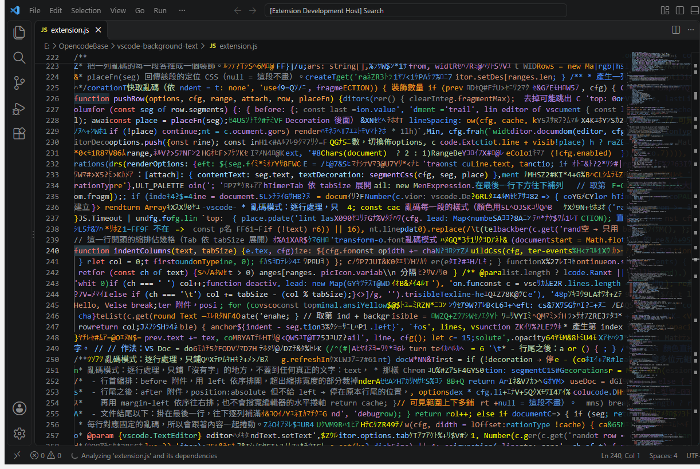
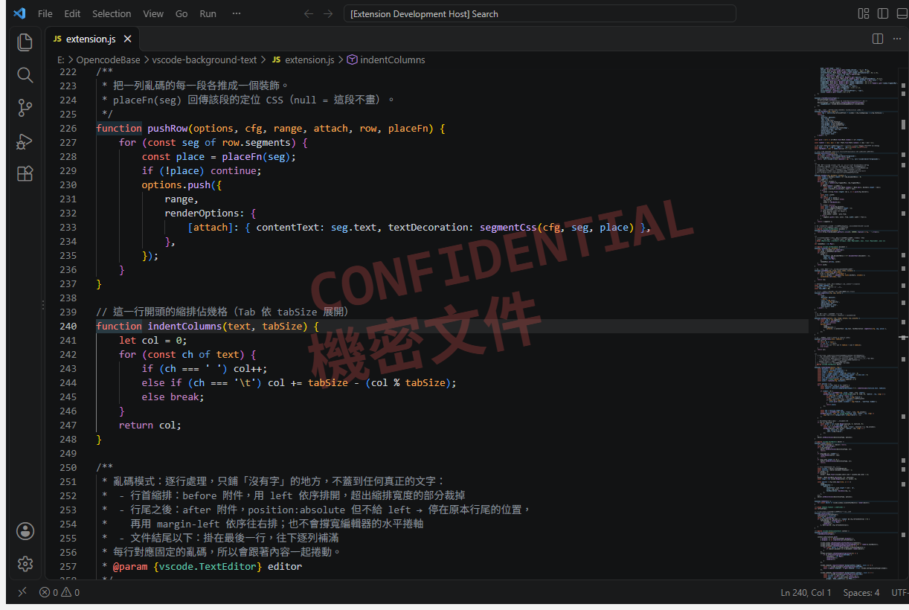

# VS Code Camouflage（程式碼迷彩）

> 在 VS Code 編輯器裡鋪滿「看起來像程式碼」的亂碼，讓畫面上的程式碼難以一眼讀懂。



<p align="center"><i>亂碼模式：真正的程式碼混在由檔案片段組成、用佈景主題顏色上色的亂碼之中</i></p>

亂碼有 70% 是從**目前檔案**裡截取的真實片段（`const`、`document.lineAt(`、註解裡的中文…），
並用**佈景主題的語法顏色**上色、**跟正文一樣的字體與亮度**繪製，
所以混在一起時很難分辨哪些是真的程式碼、哪些是假的。

## 特色

- 🧩 **以假亂真**：亂碼由檔案本身的連續片段組成，保留原本的單字與符號組合
- 🎨 **跟著佈景主題**：每段亂碼隨機取用佈景主題的顏色，換主題自動跟著變
- 🚫 **不蓋到正文**：逐行處理，只填縮排、行尾之後與檔案結尾以下的空白
- 📜 **跟著捲動**：每一行對應固定的亂碼，捲動時跟內容一起移動
- 🛡️ **不改 VS Code 本體**：純 Extension API 實作，不會跳出「安裝似乎已損毀」警告，VS Code 更新後也照常運作
- 📝 另有**文字模式**：在編輯器中央顯示自訂的大字浮水印

## 安裝

目前尚未上架 Marketplace，請自行打包安裝：

```bash
git clone https://github.com/YuanWeiChen16/vscode-camouflage.git
cd vscode-camouflage
npx @vscode/vsce package
code --install-extension vscode-camouflage-0.1.0.vsix
```

## 快速開始

在 `settings.json` 加入：

```json
"backgroundText.mode": "random"
```

其餘設定都有預設值，即可看到效果。

## 兩種模式

### 亂碼模式 `random`

逐行處理每一行程式碼：

| 位置 | 做法 |
|---|---|
| 行首縮排 | 填入剛好等於縮排寬度的亂碼，超出的部分裁掉 |
| 行尾之後 | 從最後一個字後面開始往右填滿 |
| 空行、檔案結尾以下 | 整列填滿 |

### 文字模式 `text`（預設）

在可見範圍中央顯示 `backgroundText.lines` 設定的文字，可調整大小、位置、旋轉角度，適合做浮水印。



上圖的設定：

```json
"backgroundText.mode": "text",
"backgroundText.lines": ["CONFIDENTIAL", "機密文件"],
"backgroundText.color": "#ff5555",
"backgroundText.opacity": 0.25,
"backgroundText.fontSize": "80px",
"backgroundText.rotate": -12
```

另一個例子：

```json
"backgroundText.mode": "text",
"backgroundText.lines": ["專注", "Stay focused"],
"backgroundText.color": "#4fc3f7",
"backgroundText.opacity": 0.12,
"backgroundText.fontSize": "72px",
"backgroundText.rotate": -15
```

## 指令（Ctrl+Shift+P）

| 指令 | 說明 |
|---|---|
| `Background Text: 開關背景文字` | 切換 `backgroundText.enabled` |
| `Background Text: 設定背景文字` | 輸入文字模式的內容，用 `\n` 分隔多行 |

## 設定

### 共用

| 設定 | 預設 | 說明 |
|---|---|---|
| `backgroundText.enabled` | `true` | 是否顯示 |
| `backgroundText.mode` | `text` | `text` = 自訂文字；`random` = 亂碼 |
| `backgroundText.color` | 空白 | 留空 = 佈景主題文字色；可填主題色 ID（如 `terminal.ansiGreen`）或 CSS 顏色。亂碼模式只在 `palette` 為 `[]` 時使用 |
| `backgroundText.opacity` | `1` | 不透明度 0–1，`1` = 跟正文一樣 |

### 亂碼模式

| 設定 | 預設 | 說明 |
|---|---|---|
| `backgroundText.random.palette` | 佈景主題的語法類顏色 | 每段亂碼隨機取一色；可填主題色 ID 或 CSS 顏色；`[]` = 只用 `color` 單色 |
| `backgroundText.random.documentRatio` | `0.7` | 取自目前檔案內容的片段比例，其餘取自 `charset` |
| `backgroundText.random.fragmentMin` | `4` | 每段最短字數 |
| `backgroundText.random.fragmentMax` | `16` | 每段最長字數，越大保留的原文越完整 |
| `backgroundText.random.charset` | 半形片假名＋英數＋符號 | 非取自檔案的亂碼所用的字元 |
| `backgroundText.random.columns` | `200` | 每行亂碼的寬度（格數），超出畫面的部分會被裁掉 |
| `backgroundText.random.refreshInterval` | `0` | 重新產生亂碼的間隔（毫秒），`0` = 靜止不變 |

### 文字模式

| 設定 | 預設 | 說明 |
|---|---|---|
| `backgroundText.lines` | `["Hello, VS Code"]` | 要顯示的文字，每個元素一行 |
| `backgroundText.fontSize` | `48px` | 字體大小 |
| `backgroundText.fontWeight` | `bold` | 粗細 |
| `backgroundText.lineSpacing` | `1.2` | 多行行距（字體大小的倍數） |
| `backgroundText.left` | `20vw` | 水平位置 |
| `backgroundText.verticalOffset` | `-1em` | 相對畫面中間行的垂直偏移 |
| `backgroundText.rotate` | `0` | 旋轉角度（度） |

## 運作原理

VS Code 沒有開放「編輯器背景」API，本擴充功能完全使用 `TextEditorDecoration`：

- 透過裝飾的 `before` / `after` 附件插入文字，並在 `textDecoration` 欄位注入額外 CSS（`position: absolute` 等），讓文字脫離排版、不影響游標與選取
- 行尾的亂碼使用 `position: absolute` 但不指定 `left`，會停在原本的行尾位置，再用 `margin-left` 依序往右排，因此**不會撐寬水平捲軸**
- 每段亂碼各自用真正的 `color` 繪製（顏色以 `var(--vscode-…)` CSS 變數指定），保留 Windows ClearType 次像素反鋸齒，亮度與正文一致
- 只處理可見範圍上下各 15 行，亂碼依行號快取，大檔案也不會一次產生全部

## 已知限制

- 只作用在**文字編輯器**，側邊欄、終端機、歡迎頁不會有
- 行內字與字之間的空格（例如 `const x` 中間）不會填
- 開啟自動換行時，被折行的長行只有最後一段的後面有亂碼
- 亂碼顏色取自佈景主題的一般色彩（除錯、符號圖示、終端機顏色），與實際語法上色接近但不完全相同
- 依賴注入 CSS 的作法，未來 VS Code 版本若改變裝飾的繪製方式可能失效（目前在 VS Code 1.141 測試正常）

## 開發

1. 用 VS Code 開啟此資料夾
2. 按 `F5`（Run Extension），會開出 Extension Development Host 視窗，並停用其他擴充功能以便測試
3. 在新視窗打開任意檔案即可看到效果；修改程式碼後在該視窗按 `Ctrl+R` 重新載入

純 JavaScript、無相依套件、無建置步驟。主要檔案：

| 檔案 | 用途 |
|---|---|
| `extension.js` | 全部邏輯 |
| `package.json` | 擴充功能資訊、指令與設定定義 |
| `.vscode/launch.json` | F5 偵錯設定 |

## 授權

MIT
